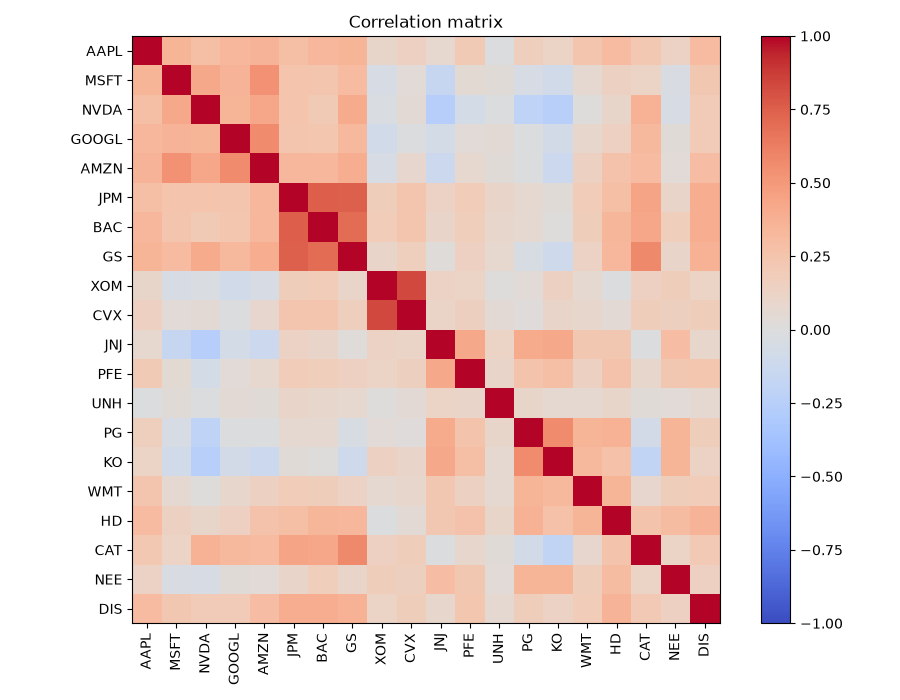
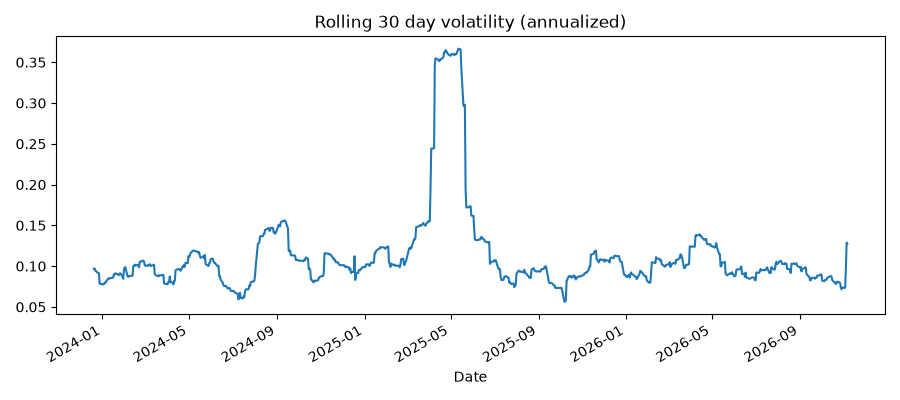
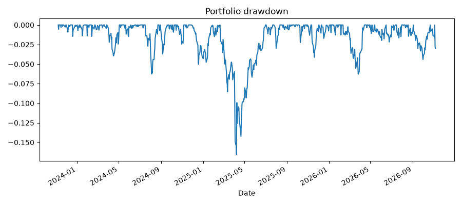

# Cloud Based Portfolio Risk Dashboard

A serverless risk analytics pipeline on AWS. It ingests daily market data for a 20 stock equity portfolio, stores it in PostgreSQL, and calculates portfolio risk metrics.

## Architecture

EventBridge (weekday schedule) → Lambda (risk_data_pull) → S3
S3 → Lambda in a private VPC (risk_db_loader) → PostgreSQL on RDS
CloudWatch alarm on Lambda errors → SNS email alert

## Risk metrics

* Historical VaR at 95% and 99%
* Parametric VaR at 95% and 99%
* Monte Carlo VaR, 10,000 simulations
* Correlation matrix, beta vs SPY, rolling 30 day volatility, max drawdown

## Sample results

Equal weighted $1M portfolio, 1 day horizon, three years of data to November 2026.

* 95% VaR: about 1.1% to 1.2%
* 99% VaR: about 1.7% to 1.9%
* Portfolio beta vs SPY: 0.72
* Max drawdown: 16.6% (April 2025)

## Design choices

* Serverless, so cost stays close to zero when idle
* Database is private with no public access
* S3 gateway endpoint instead of a NAT gateway to avoid ongoing cost
* Data check fails the run loudly if any ticker is missing, which triggers the alarm

## Limitations and next steps

* Risk scripts currently run locally on the stored data. Next step is running them in Lambda against the database.
* Parametric VaR assumes normal returns, so it understates tail risk compared with historical VaR.
* The Lambda role uses broad S3 permissions. Next step is least privilege for one bucket.
* Add tests and infrastructure as code.

## Stack

Python, pandas, NumPy, SciPy, matplotlib, yfinance, boto3, psycopg2, AWS Lambda, S3, RDS PostgreSQL, EventBridge, CloudWatch, VPC